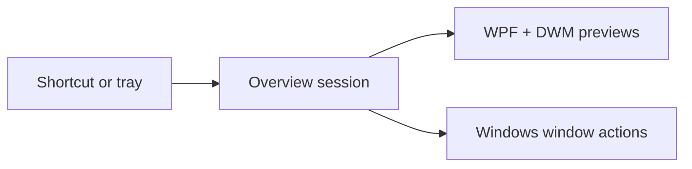

# MissionView


A window overview for Windows inspired by Mission Control on macOS.

See your open windows together and choose where to go next.

## Release status

This README describes this source revision. Download the latest packaged version from [Releases](https://github.com/JUANES545/missionview/releases) and check its release notes for the features included in that download.

Local desktop review has confirmed the centered minimized shelf, its keyboard navigation, continuous dragging between displays, and the silent App Expose shortcut when there is no application under the pointer. That review covers the tested setup, not every monitor or DPI combination. The manual updater has passed local review and automated checks; an installed upgrade from one published version to the next has not been certified.

## Features

| Feature | Behavior |
| --- | --- |
| Window overview | See live window previews across displays and select a window to switch to. |
| Configurable shortcut | Record an overview shortcut in Settings; see conflicts before applying it. The default is `Win+W`. |
| Pointer-targeted App Expose | Press `Shift` + your shortcut to show the application under the pointer, without clicking it first. An empty or ineligible target does nothing; real capture failures still produce a warning. |
| Keyboard navigation | Use arrows for directional neighbours and `Tab` / `Shift+Tab` for visual reading order and its reverse. Press `Enter` to switch or `Escape` to cancel. |
| Hold-to-preview | Hold `Space` to enlarge the selected live preview; navigate while holding it to preview another window. |
| Minimized-window shelf | In App Expose, browse real titles and available application icons in a compact shelf centered on each display. Scroll or navigate overflow without restoring a window until confirmation. |
| Move between displays | Drag a normal window's preview across display boundaries. The preview spans both displays; release chooses the display under the pointer. `Escape` cancels. |
| Show and restore desktop | Use the overview button, `Alt+S`, or the tray action to reveal the desktop and restore windows. |
| Hot corners and startup | Enable a hot corner, choose its position and delay, and control **Start with Windows**. |
| Settings and tray | See the running build's version in the tray's right-click menu; open Settings, the overview, desktop controls and manual updates. Save preferences with conflict reporting and rollback on failure. |
| Manual updates | Check from Settings or the tray, download with progress, verify the release origin and installer hash, then confirm before starting Setup. No periodic checks. Installed-upgrade validation remains pending. |

## Download and installation

Download the MissionView Setup executable from [Releases](https://github.com/JUANES545/missionview/releases). Run Setup, choose an installation folder, then open MissionView from the Start menu. Use its system tray icon to access the controls.

Requires Windows 11 x64, version 24H2 (build 26100) or later. The download includes the .NET runtime; you do not need to install .NET or a developer SDK.

## Using MissionView

Open the overview with your configured shortcut, then click a window to switch to it. Press `Escape` or click the background to cancel.

For a normal window, drag its preview toward another display to move it. During the gesture, the preview keeps its size and appears across display boundaries while the real window stays in place. Release over the destination display to move the window, or press `Escape` to cancel. The pointer position at release decides the destination, not the largest share of the preview. Releasing in a gap between displays does not choose a nearby display.

| Key | Action |
| --- | --- |
| Configured shortcut | Open the overview; press again to confirm the selection |
| `Shift` + configured shortcut | Show windows from the application under the pointer |
| Arrow keys | Select a neighbour in that direction; stay put at the edge |
| `Tab` / `Shift+Tab` | Follow visual reading order / its exact reverse, wrapping at the end |
| `Enter` | Switch to the selected window |
| Hold `Space` | Preview the selected window |
| `Escape` | Cancel without switching |

Arrows use thumbnail edges, preferring a window aligned with the selected one, including across displays. `Tab` reads each display left to right by visual rows, then its minimized strip, before the next display in physical order. Scrolling and previewing do not reorder this cycle. Inside the minimized strip, navigation scrolls a selected tile into view without restoring its window. When navigating while holding `Space`, the preview briefly returns to its overview slot before the next selection expands. Show desktop is a mouse or `Alt+S` action, outside the thumbnail navigation.

App Expose derives its shortcut from your configured overview shortcut. For example, `Win+F12` becomes `Win+Shift+F12`; the default remains `Win+W`. An existing shortcut that includes `Shift` still opens the general overview, with App Expose unavailable until you choose a shortcut without `Shift`.

Point to an application window before pressing the App Expose shortcut; you do not need to click or activate it. MissionView captures the pointed window before opening its overlay. If there is no eligible application window under the pointer (for example, over the desktop, taskbar or a tooltip), the shortcut does nothing: no warning, overview or focus change. It never falls back to another application. Capture and identity failures still show a warning. The general overview shortcut works over the desktop as before. Pressing the shortcut again inside App Expose confirms the selected window; `Escape` returns to the application that had focus before the overview.

Windows must allow both shortcut reservations for a new assignment. If it cannot reserve your existing shortcut at startup, MissionView preserves that shortcut's existing keyboard-hook behavior, leaves App Expose disabled and shows a warning. Saving other preferences or rolling back a failed save preserves this compatibility behavior.

The general overview excludes minimized windows. App Expose includes them in a compact bottom shelf centered horizontally on each display, with their real titles and application icons when available. The shelf fits its items, up to four columns and two visible rows, with vertical scrolling for overflow; short displays use one visible row. Selection uses an outline and check mark, with a separate keyboard-focus cue and native accessibility selection state. They stay minimized until you confirm one with `Enter`, a click, or the shortcut again. `Space` explains that minimized windows have no live preview in this view. Moving minimized windows between displays is unavailable. The existing limit of 20 windows per display also applies to App Expose; a status message reports overflow.

Application grouping uses a window's explicit application ID when available, then a packaged application ID or full executable path. This includes separate processes of the same installed browser or desktop application without relying on process ID alone. Known shared hosts require a per-window application ID, so unrelated hosted applications do not merge. Windows with inaccessible or ambiguous identity stay out of App Expose, with a status message; an identity error never opens the all-application overview instead.



## Settings

Open **Settings...** from the system tray to record an overview shortcut, enable or disable hot corners, choose a corner and delay, or change **Start with Windows**. Changes take effect when you choose **Save**. If a shortcut conflicts or Windows cannot save or apply a preference, MissionView reports the error and attempts to restore the previous preferences. It also reports restoration failures.

Settings groups these controls under **General**, **Shortcuts**, **Hot corners**, and **Updates & About**. Start with Windows is in General; the tray keeps the main actions and running version. Narrow windows stack preference rows, with scrolling available when space is limited.

Record App Exposé separately in **Shortcuts** to use an independent key combination. It must include Ctrl, Alt or Win and differ from the overview shortcut. Existing profiles keep the inherited Shift shortcut until you change it. Both shortcuts are checked and applied together on Save.

Preferences live in `%LOCALAPPDATA%\MissionView\settings.json`. MissionView preserves an existing profile and migrates a legacy `settings.json` beside the executable only when the user profile does not exist. Renderer and animation values remain in the file; Settings does not expose controls for them.

Choose **Check for updates...** in the tray or Settings to check manually; MissionView does not poll for updates. Both controls share the same update operation. You can download an available update and follow its progress while MissionView checks the release origin and installer hash. Before starting Setup, MissionView asks you to save or discard pending settings and confirm installation. The confirmation explains the limits of publisher and Windows-version verification; Windows may still show publisher, SmartScreen or UAC warnings. MissionView closes only after Setup starts.

## Development

MissionView uses C#/.NET 10, WPF and DWM in one production project. Build with `dotnet build .\WindowScatter.csproj -c Release`. The following notes describe source boundaries, resource ownership and regression commands.

<details>
<summary>Architecture and regression checks</summary>

### Source architecture

Build `WindowScatter.csproj` to produce `MissionView`. The application keeps C#/.NET 10, WPF and DWM in one production assembly. `App.xaml` remains the entry point; the namespace stays `WindowScatter` so XAML classes and existing integrations keep their names.

| Area | Responsibilities and dependency direction |
| --- | --- |
| `Core` | Window identity/data, physical layout and preview geometry, navigation rules, preferences and update descriptors. Uses the base runtime, without WPF, Win32, filesystem or process effects. |
| `Application` | `OverviewSession` coordinates selection, stable Tab snapshots, directional navigation, deferred close requests and preview-return completion. `PreferencesService` owns save/apply/rollback order. `UpdateController` owns the shared manual-update state machine. Depends on Core; delegates or `IUpdateService` provide effects. |
| `Infrastructure` | `Windows` captures/revalidates HWND identities, enumerates and activates windows, moves windows, handles desktop/hot corners and startup registration. `Preferences/JsonSettingsStore` owns profile paths, migration and atomic JSON writes. `Updates/UpdateService` owns HTTP validation, hashes, locked installer verification and temporary files. Adapters depend inward. |
| `Presentation/Wpf` | Overview/Settings/Updates/Tray views, input adapters, UIA peers and shared theme resources. `Rendering` owns HWND-bound WPF/DWM surfaces and animation. Views pass arranged geometry to Application and apply its decisions; they keep the existing native rendering operations rather than binding each animation coordinate. |

Put a new window rule or geometry algorithm in Core, a cross-display/session decision in Application, and an OS/disk/network effect in Infrastructure. Put controls, automation peers and visual state in Presentation. The shared namespace does not enforce these boundaries; the compile checks below and the portable source-boundary test do.

`App.OnStartup` composes `ApplicationServices` after loading the profile. Display views share its session, preferences, activation and transfer services. Settings and the tray share one lazily created update controller, owned and disposed by the coordinator view. Each view creates its renderers only after obtaining its HWND, then releases DWM thumbnails, capture resources and event subscriptions during its existing cleanup path. Source HWNDs belong to other applications; MissionView does not own them.

`WindowInfo`, `WindowLayout` and `WindowPreviewState` contain data without controls. `WindowThumb` adds the WPF borders/title and the DWM thumbnail handle. Layout, native window rectangles and animation state use physical pixels; `PhysicalWindowRect` retains integer edges and preview bounds retain doubles. The Windows discovery adapter projects native RECT values into that data model. WPF adapters divide by the effective DPI scale when arranging DIP controls and publish physical rectangles for navigation. No implicit physical/DIP conversion exists.

The UI dispatcher serializes session, selection and view changes. Before returning an expanded preview, `OverviewSession` marks navigation pending; it accepts one completion per display and rejects callbacks from cancelled or replaced sessions. The low-level shortcut adapter still captures the pointer window before scheduling an overlay. Animation workers retain their existing render-state synchronization; native move work retains its timeout/cancellation handling. The updater runs I/O away from the dispatcher and publishes state through its captured synchronization context. Preferences still save and roll back through the same transaction, JSON format and registry value.

Closing the update controller and finishing its operation share cleanup ownership under one lock. A temporary-file cleanup error still propagates after the controller releases the HTTP client. After Setup starts, MissionView keeps the downloaded installer for Setup; starting the process does not confirm installation.

### Continuous drag preview

`MainWindow.Drag` coordinates the drag across the existing overview surfaces. `Core/DragPreviewGeometry` fixes the preview size from the origin thumbnail/monitor and rounds the grab offset once. Pointer movement translates one desktop-pixel rectangle, including across negative coordinates, vertical arrangements and display gaps. Each `Infrastructure/Windows/DwmDragPreview` owns one DWM registration and draws its monitor's intersection. Shared edges map to shared integer source edges, so a partial crossing shows complementary pieces before the pointer crosses. Destination DPI does not resize the preview; simulated mixed-DPI fixtures check this physical-pixel policy.

The adapter uses the full-window dimensions from `DwmQueryThumbnailSourceSize` and explicit `rcSource` crops with `fSourceClientAreaOnly=false`. This includes the real window frame rather than mixing client-area coordinates or extended-frame offsets into a full-window crop. It revalidates HWND/TID/PID and source dimensions while drawing and before release. A missing, minimized, resized or unrepresentable source cancels with an error; MissionView does not substitute a different image.

The window remains in its original position during preview. Release chooses the display containing the pointer, even when most of the preview remains elsewhere. Release in a gap has no nearest-display fallback. Escape, capture loss and failures release the drag registrations without confirming a move. The existing display limit, topology checks and final window-placement policy still apply. Local desktop review covers the tested display arrangement; broader seam and mixed-DPI hardware checks remain pending. Off-screen HWND tests verify API calls and cleanup, not those pixels.

`Infrastructure/Windows/Experimental` contains the unused DirectComposition renderer/host, including private ordinal experiments. The production project excludes those files; `spike/DCompSpike` remains a separate experiment. The active overview continues to use DWM, regardless of the retained `Renderer` preference. Priority, working-set, timer and keepalive behavior remain unchanged; this reorganization makes no performance claim.

### Architecture and regression checks

Compile the actual inner-layer source without Windows adapters, WPF references or platform stubs:

```powershell
dotnet build .\tests\WindowScatter.CoreCheck -c Release
dotnet build .\tests\WindowScatter.CoreCheck -c Release -p:IncludeApplication=true
dotnet test .\tests\WindowScatter.LayoutTests -c Release
```

`CoreCheck` has no package dependencies. It compiles Core alone, then Core plus Application; its only suppressed diagnostic is the unassigned DTO-field warning from omitting native producers. The portable suite also rejects platform imports, process launch and direct filesystem effects inside these layers. CI runs both checks before the existing suites.

On a shared desktop, omit the WPF test that reserves global F23/F24 shortcuts:

```powershell
dotnet test .\tests\WindowScatter.WpfTests -c Release --filter "FullyQualifiedName!~NativeRegistrationConflictRollsBackPairOnDedicatedMessageOnlyHandles"
dotnet test .\tests\MissionView.UpdateTests -c Release
dotnet build .\WindowScatter.csproj -c Release
```

The remaining native fixtures create their own off-screen windows. They do not establish physical acceptance, screen-reader compatibility or installed-update behavior. Normal thumbnails expose their full window titles through UI Automation, while visual labels retain the 80-character limit. Their Invoke action uses the existing activation path, and SelectionItem state follows overview selection across normal and minimized windows. Each display's normal-thumbnail list exposes the current selection; the minimized shelf retains its own SelectionItem/Invoke state.

</details>

## Validation limits

Local review and automated tests do not certify accessibility, performance or mixed-DPI support across hardware. Screen-reader checks and an installed version-to-version update remain pending. The development notes above record the known normal-thumbnail accessibility gap.

## Feature videos

Recordings are coming. These spaces are ready for uploads.

### Find and switch

Open the overview, preview a window and switch to it.

> Video space: 16:9. Replace this note with the uploaded recording.

### Show the desktop

Reveal the desktop, then restore your windows.

> Video space: 16:9. Replace this note with the uploaded recording.

### Room for an ultrawide

See the window overview across a 5120 x 1440 desktop.

> Video space: 32:9, 5120 x 1440. Replace this note with the uploaded recording.

### Move between displays

Drag a preview across the display boundary, then release over the destination.

> Video space: 16:9. Replace this note with the uploaded recording.

[MIT](LICENSE). Based on [miguelo96/WindowScatter](https://github.com/miguelo96/WindowScatter), via [RuoChen5251/WindowScatter](https://github.com/RuoChen5251/WindowScatter). Original copyright notices remain in LICENSE.
