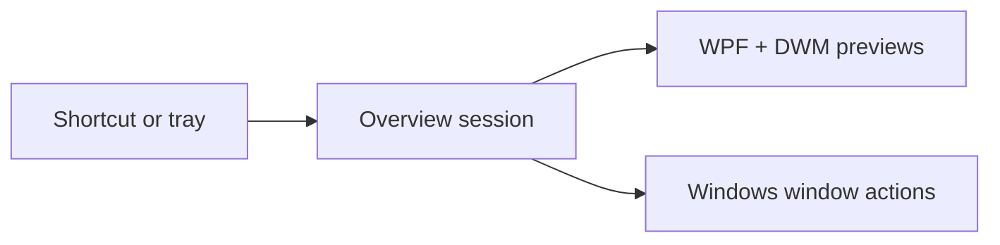

# MissionView

A Mission Control-style window overview for Windows.

See your open windows together and choose where to go next.

## Download and installation

Download the MissionView Setup executable from [Releases](https://github.com/JUANES545/missionview/releases). Run Setup, choose an installation folder, then open MissionView from the Start menu. Use its system tray icon to access the controls.

Requires Windows 11 x64, version 24H2 (build 26100) or later. The download includes the .NET runtime; you do not need to install .NET or a developer SDK.

## Using MissionView

Open the overview with your configured shortcut, then click a window to switch to it. Press `Escape` or click the background to cancel.

| Key | Action |
| --- | --- |
| Configured shortcut | Open the overview; press again to confirm the selection |
| `Tab` / `Shift+Tab` | Select the next / previous window |
| `Enter` | Switch to the selected window |
| Hold `Space` | Preview the selected window |
| `Escape` | Cancel without switching |

## Feature videos

Recordings are coming. These spaces are ready for uploads.

### Find and switch

Open the overview, preview a window and switch to it.

> Video space: 16:9. Replace this note with the uploaded recording.

### Show the desktop

Reveal the desktop, then restore your windows.

> Video space: 16:9. Replace this note with the uploaded recording.

### Room for an ultrawide

See the window overview across a 5120 x 1440 desktop.

> Video space: 32:9, 5120 x 1440. Replace this note with the uploaded recording.

<!-- Add "Move between displays", a short description and a 16:9 video space only after physical acceptance. -->

[MIT](LICENSE). Based on [miguelo96/WindowScatter](https://github.com/miguelo96/WindowScatter), via [RuoChen5251/WindowScatter](https://github.com/RuoChen5251/WindowScatter). Original copyright notices remain in LICENSE.
